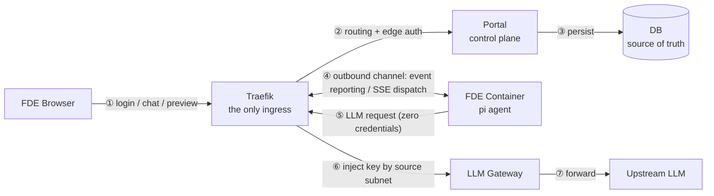
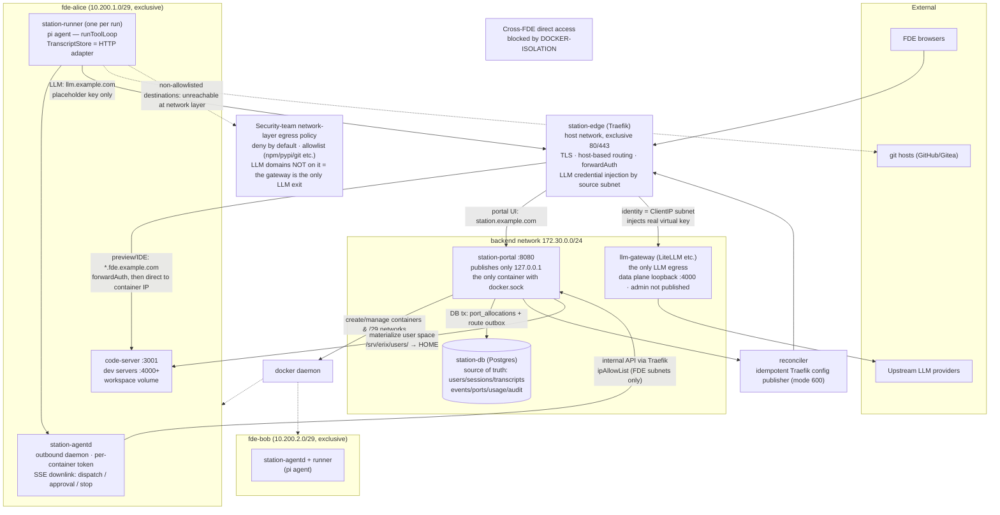
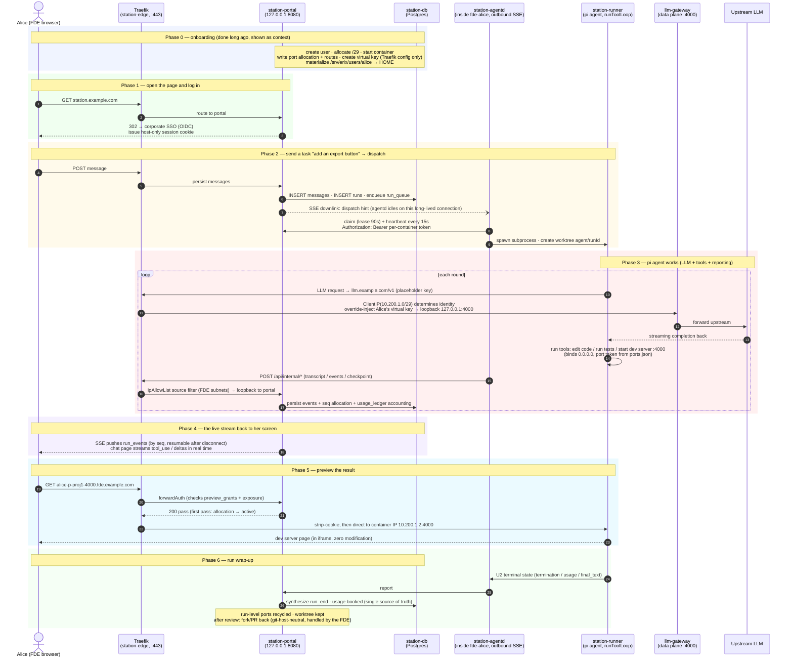
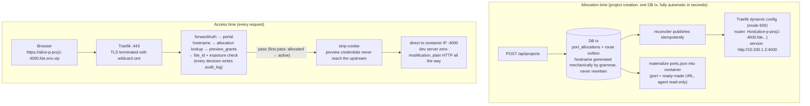

# Architecture Charts (English)

> Three charts: ① simplified data flow (PPT-level) ② network architecture ③ end-to-end sequence.
> Spec source: `docs/design/fde-platform.md`; for topology details defer to `docs/design/topology.md`.
> Chinese version: [`charts.zh.md`](charts.zh.md).

---

## Chart 1 · Simplified Data Flow (PPT-level)

### Key points

- **Six actors**: browser, Traefik, Portal, DB, FDE container, LLM gateway — every line connects only these
- **All traffic goes through Traefik**: browser, containers, LLM alike; "not in the route table = unreachable"
- **Portal is the sole DB writer**: containers never touch the DB; events/state land via the internal API through portal
- **Containers are outbound-only**: zero listeners, zero platform secrets (only a per-container token); dispatch arrives over SSE downlink
- **LLM credentials are injected at the edge**: containers hold only a placeholder key; the real virtual key is override-injected by Traefik based on source subnet

---

## Chart 2 · Network Architecture

### Key points

- **Traefik runs on the host network**: reaches every `/29` with zero docker network attachment; `--api=false`, admin surface fully closed
  > `api` refers to Traefik's built-in REST API + Dashboard (`api@internal` routers). When enabled, `/api/http/routers|services|middlewares` return the full effective configuration: every router rule, every service backend address, every middleware definition — i.e. all FDE container IPs, port allocations, preview hostnames, plus the exact CIDRs of the internal `ipAllowList` and the existence pattern of LLM credential-injection middlewares. In this architecture FDE containers are unavoidable Traefik clients holding root: enabling the API hands any compromised container the full platform recon dataset for lateral movement. Hence `api: false` is written explicitly in static config (not left to the default) and listed in the hardening checklist with an acceptance item: the closed admin surface is an immutable ingress property, not an ops habit
- **backend (172.30.0.0/24)**: portal + DB + LLM gateway; portal publishes only loopback `127.0.0.1:8080`
- **One exclusive `/29` per FDE**: `fde-alice` / `fde-bob` cannot reach each other; isolation is guaranteed by topology (DOCKER-ISOLATION), zero configuration
- **Container → portal is outbound-only, via Traefik**: ipAllowList derived precisely from `fde_networks`, then looped back to portal
- **LLM identity = source subnet**: Traefik's `ClientIP` match triggers Authorization override-injection; no matching source → 404 = deny by default
- **Portal is the sole control-plane writer**: only container with docker.sock; port allocation + route outbox written in one DB tx, reconciler publishes routes idempotently

### Why the network is designed this way (security rationale)

> Full argument in `topology.md` (§6 hardening checklist, §7 connectivity matrix, §8 residual risk); design motivations only here.

- **Controlled egress (not free internet access)**: FDE containers have a shell — file permissions can't stop them from editing configs; **the only effective guarantee is "the network cannot reach it"**. The egress allowlist is enforced at the network layer by the security team; LLM domains are **not** on the allowlist → the gateway is the only reachable LLM exit, so changing endpoint/key is pointless
- **LLM calls require no key inside the container**: containers hold **zero LLM credentials** — their config contains only a placeholder key plus `endpoint=llm.example.com`; the real virtual key lives solely in the host's Traefik dynamic config (mode 600, writable only by portal, read-only for Traefik). As a request crosses the edge, identity is determined by **source subnet** and `Authorization` is **override-injected** (any key the container presents is overwritten). Security value: even a fully compromised container (root included) yields **no LLM credentials at all**; keys never touch container disks or env vars, so there is no leakage surface to audit
- **FDEs cannot reach each other (no loss of control)**: shared networks are the root cause of lateral privilege escalation — the original shared `control` network was abolished for exactly this reason. Each FDE owns an exclusive `/29`; cross-bridge forwarding is dropped by DOCKER-ISOLATION — isolation with zero configuration and no workaround
- **Container → host services must be closed too**: it was measured that FDE containers could reach host gitea/mssql/portainer via the gateway IP — hence a **layered firewall** (INPUT for host-local services + DOCKER-USER for forwarding/publish), rules generated from precise CIDRs in `fde_networks`
- **Identity = network location**: both the internal API and LLM links authenticate by source subnet (ipAllowList / ClientIP), with credentials override-injected by Traefik — tokens can't be stolen, forged headers are killed by `aliasHeadersStrategy: delete` and "never read X-Forwarded-For"
- **Defense in depth**: topology isolation (unreachable) + edge auth (forwardAuth) — **both layers required, neither suffices alone**; containers are zero-listener with zero platform secrets → even if compromised, there are no credentials to steal and no inbound path to exploit
- **Residual risk, explicitly accepted**: FDEs are root inside their own container and can forge **their own** events/usage; cross-FDE is blocked by portal ownership checks (cannot affect others, cannot escalate to DB/LLM credentials) — a deliberate trade-off, not an oversight

---

## Chart 3 · End-to-End Sequence (what happens after an FDE opens the page)

### Key points

- **Phase 1 — auth entirely at the edge**: SSO/OIDC + session cookie; applications never handle authentication themselves
- **Phase 2 — portal never connects to containers**: the dispatch hint rides the existing SSE long connection; agentd claims outbound (lease + heartbeat)
- **Phase 3 — the heart of the system**: LLM identity from the source subnet, state via outbound reporting into the DB — containers stay zero-listener, zero-secrets, DB-blind
- **Phase 4 — events persist first, then stream**: portal restarts don't kill tasks; multi-device sync; resumable by seq after disconnect
- **Phase 5 — preview with zero modification**: forwardAuth edge authorization + strip-cookie; the dev server never knows
- **Phase 6 — single source of truth for accounting**: `run_end` is synthesized by portal; usage from terminal-state reporting, reconciled with gateway usage periodically

---

## Mechanism Deep-Dive · The Preview Access Chain (port allocation → edge auth → container)

> Spec refs: `fde-platform.md` §8 / §5.3 / §6, `topology.md` §4-L2, `portal.md` §2.7–2.8. This mechanism simultaneously achieves "users open a preview like any normal website" and "containers have zero inbound, zero published ports, and cannot self-register routes".

### Why it is elegant (five points)

- **DB is the truth, routes are its shadow**: allocation, reconfiguration, and recycling are all DB operations; the three derived artifacts (Traefik config, ports.json in the container, the URL) stay in sync automatically — there is no "manual sync" step and no "FDE self-registers a route" opening. **Not in the route table = unreachable** is a verifiable security property
- **Domains are dynamically obtained but not freely chosen**: the hostname is generated mechanically by the grammar (fde + project name + port) — free-form hostnames are deliberately forbidden, otherwise the property above could be bypassed by "naming my own service"; wildcard DNS + wildcard cert mean every new allocation requires **zero DNS/certificate work**
- **Auth entirely at the edge, dev servers zero-modification**: the agent's app adds no login, no TLS, no CORS; forwardAuth decides in the Traefik middleware layer, and the credential system (one-time ticket → host-only preview cookie) is isolated from the portal login state — forwarding the link to someone else = 401
- **Encryption responsibility concentrated in one place**: plain HTTP inside the container (the native form of dev servers), TLS seamlessly taken over by Traefik; plaintext exists only inside the single-FDE exclusive `/29` — no man-in-the-middle position exists
- **Listen surface equals reachable surface exactly**: the dev server binds 0.0.0.0 (against convention) only because its sole client is the host's Traefik; ports are not published and cross-FDE traffic is dropped by DOCKER-ISOLATION — the actual reachable range of "listening on 0.0.0.0" collapses to a single point at the edge
