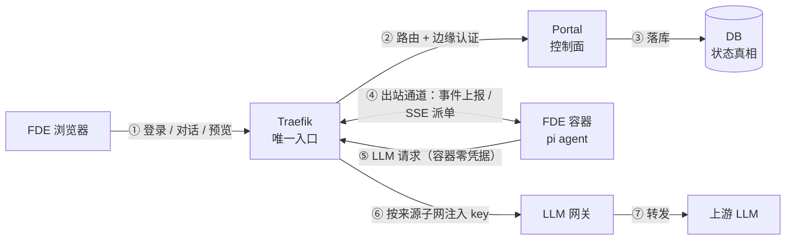
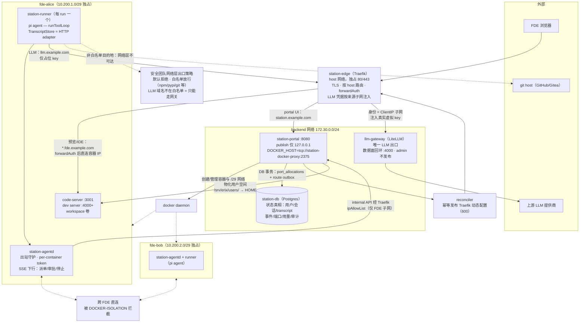
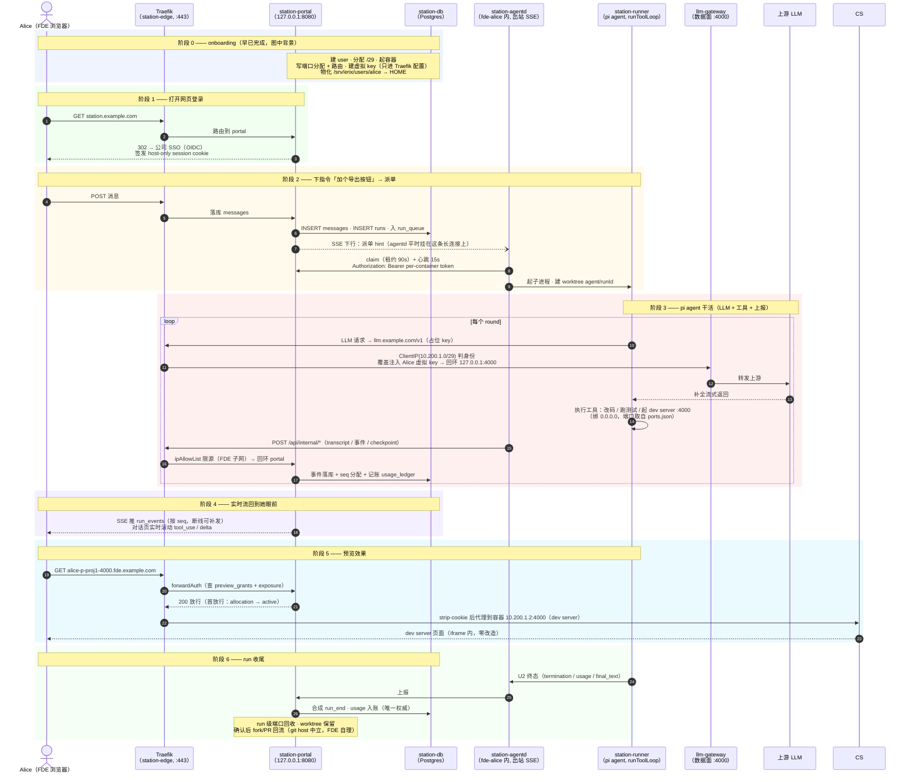
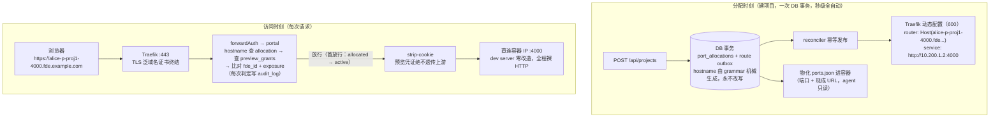

# 架构图（中文版）

> 三张图：① 简化数据流（PPT 级）② 网络架构 ③ 端到端时序。
> 规格来源：`docs/design/fde-platform.md`；拓扑细节以 `docs/design/topology.md` 为准。
> 英文版见 [`charts.en.md`](charts.en.md)。

---

## 图 1 · 简化数据流（PPT 级）

### 要点

- **六个主体**：浏览器、Traefik、Portal、DB、FDE 容器、LLM 网关——所有线都只连它们
- **一切流量只过 Traefik**：浏览器、容器、LLM 全是；「路由表里没有 = 不可达」
- **Portal 是 DB 唯一写方**：容器不直连 DB，事件/状态全经 internal API 由 portal 落库
- **容器只出站**：平台通道零入站监听、零平台密钥（仅 per-container token），派单走 SSE 下行
- **LLM 凭据在边缘注入**：容器内只有占位 key，真实虚拟 key 由 Traefik 按来源子网覆盖注入

---

## 图 2 · 网络架构

### 要点

- **Traefik 在 host 网络**：零 docker 网络接入即天然可达所有 `/29`；`--api=false`，管理面全关
  > `api` 指 Traefik 内建的 REST API + Dashboard（`api@internal` 路由）。开启时 `/api/http/routers|services|middlewares` 返回完整生效配置：全部 router 规则、每个 service 的后端地址、middleware 定义——即全部 FDE 的容器 IP、端口分配、预览域名，以及 internal `ipAllowList` 的精确 CIDR 与 LLM 凭据注入规则的存在方式。本架构中 FDE 容器是 Traefik 的必然访问者且持 root，开 api 等于向已沦陷容器免费提供全平台横向侦察数据。故静态配置显式写 `api: false`（不依赖默认值），并列入加固清单与验收项：管理面关闭是 ingress 的不可变属性，非运维习惯
- **backend（172.30.0.0/24）**：portal + DB + LLM 网关；portal 只 publish 回环 `127.0.0.1:8080`
- **每 FDE 一条独占 `/29`**：`fde-alice` / `fde-bob` 互不相通，隔离由拓扑保证（DOCKER-ISOLATION），零配置
- **容器 → portal 全出站、经 Traefik**：ipAllowList 由 `fde_networks` 精确派生，回环到 portal
- **LLM 身份 = 来源子网**：Traefik `ClientIP` 判定后覆盖注入 `Authorization`；无匹配来源 404 = 默认拒绝
- **portal 是唯一控制面写手**：docker.sock 只挂 station-docker-proxy（portal 经 proxy 访问 Docker API）；端口分配 + route outbox 同事务落 DB，reconciler 幂等发布路由

### 为什么这样设计网络（安全考量）

> 完整论据见 `topology.md`（§6 加固清单、§7 连通矩阵、§8 残余风险）；此处只列设计动机。

- **出站受控（不是什么网都能上）**：FDE 容器虽有 shell，无法靠文件权限阻止他改配置——**唯一有效的保证是「网络到不了」**。出口白名单由安全团队在网络层实施；LLM 域名**不在**白名单 → 网关是唯一可达的 LLM 出口，改 endpoint/换 key 均无效
- **LLM 调用无需容器持钥**：容器内**零 LLM 凭据**——config 里只有占位 key + `endpoint=llm.example.com`；真实虚拟 key 只存在于宿主 Traefik 动态配置（600，仅 portal 可写、Traefik 只读），请求过边缘时按**来源子网**判定身份后**覆盖注入** `Authorization`（容器自带的任何 key 均被覆盖）。安全价值：即使容器被完全攻破（含 root），也**拿不到任何 LLM 凭据**；且凭据永不落到容器磁盘/环境变量，无泄漏面可审计
- **FDE 之间互不可达（防失控）**：横向越权的根因是共享网络——原 `control` 共享网络因此被取消。每 FDE 独占 `/29`，跨 bridge 转发被 DOCKER-ISOLATION 丢弃，隔离零配置、无第二条路
- **容器 → 宿主服务也要堵**：实测 FDE 容器经网关 IP 可达宿主 gitea/mssql/portainer——故用**分层防火墙**（INPUT 管宿主本地服务 + DOCKER-USER 管转发/publish），规则由 `fde_networks` 精确 CIDR 生成
- **身份 = 网络位置**：internal API 与 LLM 链路都按来源子网判定（ipAllowList / ClientIP），凭据由 Traefik 覆盖注入——凭证偷不走、伪造头被 `aliasHeadersStrategy: delete` 与「不读 X-Forwarded-For」堵死
- **纵深防御**：拓扑隔离（网络不可达）+ 边缘认证（forwardAuth）**两层缺一不可**；容器平台通道零入站、零平台密钥 → 即使被攻破也无凭据可偷、无入口可打
- **明示接受的残余风险**：FDE 是自己容器的 root，可伪造**自己的**事件/用量；跨 FDE 由 portal 归属校验挡住（不能影响他人、不能越权读 DB/凭据）——这是有意为之的取舍，不是疏漏

---

## 图 3 · 端到端时序（FDE 打开网页之后发生什么）

### 要点

- **阶段 1 认证全在边缘**：SSO/OIDC + session cookie；应用自身不感知认证
- **阶段 2 portal 不主动连容器**：派单 hint 走既有 SSE 长连接，agentd 出站 claim（租约 + 心跳）
- **阶段 3 是系统心脏**：LLM 身份靠来源子网、状态靠出站上报落 DB——容器平台通道零入站、零密钥、不碰 DB
- **阶段 4 事件先落 DB 再推 SSE**：portal 重启不杀任务、多端同步、断线按 seq 补发
- **阶段 5 预览零改造**：forwardAuth 边缘授权 + strip-cookie，dev server 无感知
- **阶段 6 记账唯一权威**：`run_end` 由 portal 合成；usage 以终态上报为准，与网关用量定期对账

---

## 机制解析 · 预览访问链路（端口分配 → 边缘认证 → 容器）

> 对应规格：`fde-platform.md` §8 / §5.3 / §6，`topology.md` §4-L2，`portal.md` §2.7–2.8。这套机制同时做到了「用户像访问普通网站一样点开预览」和「容器零入站、零发布、不自注册路由」。

### 巧妙在哪（五点）

- **DB 是真相，路由是影子**：分配、改配、回收全是 DB 操作；Traefik 配置、容器内 ports.json、URL 三处派生物自动同步——不存在任何「手工同步」步骤，也没有「FDE 自注册路由」的口子。**路由表里没有 = 不可达**是一条可验证的安全性质
- **域名动态获得、不可自选**：hostname 由 grammar（fde + 项目名 + 端口）机械生成——自由拼域名被刻意禁止，否则上面的安全性质就被「我给自己的服务起个名」绕开；泛域名 DNS + 泛域名证书让每条新分配**零 DNS/证书操作**
- **认证全在边缘，dev server 零改造**：agent 写的 app 不加登录、不管 TLS、不配 CORS；forwardAuth 在 Traefik 中间件层完成判定，凭证体系（一次性 ticket → host-only 预览 cookie）与 portal 登录态隔离——链接转发给别人 = 403（preview_ticket_required / preview_ticket_used）
- **加密责任集中一处**：容器内裸 HTTP（dev server 原生形态），TLS 由 Traefik 无缝接管；明文只存在于单 FDE 独占 `/29` 内——不存在中间人位置
- **监听面与可达面精确相等**：dev server 绑 0.0.0（反常规）只因唯一的客户端是宿主 Traefik；端口不 publish、跨 FDE 被 DOCKER-ISOLATION 拦——「监听 0.0.0.0」的实际可达范围收敛为边缘一个点
